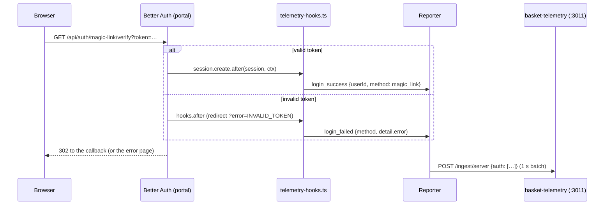
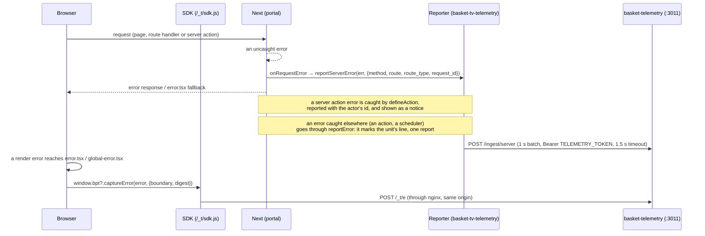

# Telemetry

The portal reports to [basket-telemetry](https://github.com/WencesCapolo/basket-telemetry), the superadmin panel on
`server.basket-app.com`: page views, active time, clicks and browser errors through the SDK, and server errors and a
few business events through a server reporter, and auth events (basket-telemetry SPEC §11, tasks T1.9 and T2.5). How an app integrates, the
reporter contract and the privacy rules are in
[basket-telemetry/docs/sdk.md](https://github.com/WencesCapolo/basket-telemetry/blob/main/docs/sdk.md); this page
covers the portal only.

Nothing personal leaves the portal in an event: props are ids, counts and enums, never emails, names or free text.
Error messages are scrubbed before they are sent (see below).

## What is sent

| From | What | Where |
|---|---|---|
| Browser | page views, active time, clicks, `window.onerror` and `unhandledrejection` | the SDK: `<Script src="/_t/sdk.js">` in `src/app/layout.tsx`, after the 1-line stub that queues `window.bpt` calls until it loads |
| Browser | a render error that reaches the root | `src/app/error.tsx` and `src/app/global-error.tsx` call `window.bpt?.captureError` (`captureBoundaryError` in `src/lib/telemetry-browser.ts`) and show the Spanish fallback (`src/components/errors/error-fallback.tsx`) |
| Server | an uncaught error of a render, route handler, server action or the proxy | `onRequestError` in `src/instrumentation.ts`, with the method, the route pattern (`/match/[id]`, never the concrete path), the route type and the `request_id` of the log line the error marked; `register()` and its schedulers are unchanged |
| Server | an error thrown inside a server action's `run` | `src/lib/actions/define-action.ts`. Parse failures, a returned `{ error }`, a `DomainError` and an authz failure shown as a notice are not reported |
| Server | an unexpected error caught before it reaches either hook | `reportError` in `src/lib/log.ts`, from the catch blocks listed in [Caught errors](#caught-errors) |
| Server | business events | the actions below |

`window.bpt` is typed in `src/types/bpt.d.ts`, copied from basket-telemetry `src/sdk/sdk.d.ts`.

The server reporter is the shared package [basket-tv-telemetry](https://github.com/WencesCapolo/basket-tv-telemetry)
(`createReporter`), created once in `src/lib/telemetry.ts` as `telemetry` (`telemetry.reportServerError`,
`telemetry.trackServerEvent`). The package owns batching (1 s, one `POST` to the loopback ingest with
`Authorization: Bearer <TELEMETRY_TOKEN>`), the 1.5 s timeout, the 200-item queue cap and the scrubbing of error
messages (`scrubMessage`: cut at `params:`, emails, quoted values, objects, numbers and amounts masked); its fixtures
pin both. Without `TELEMETRY_TOKEN` (dev, tests, CI) it does nothing. Inside a wide event it fills `request_id`,
`method`, `route`, `status` and `userId` from the event, so a report links to its log line. `src/lib/telemetry.ts`
keeps only the app's config and the Portal's own auth-event sender (below). Next bundles the package: it stays out of
`serverExternalPackages`, and `vitest.config.mts` inlines it for the same reason. The package is Node-only (`node:crypto`,
`node:async_hooks`) and Next bundles `src/instrumentation.ts` into the edge middleware too, so `instrumentation.ts`
loads it and `src/lib/telemetry.ts` only with a dynamic `import()` behind `process.env.NEXT_RUNTIME === "nodejs"`,
and nothing `middleware.ts` imports may reach them or `src/lib/log.ts`; CI's smoke step catches a slip.

## Caught errors

`onRequestError` and `defineAction` see only what is thrown. Code that catches an error and carries on (an action that
answers `{ ok: false }`, a scheduler, a best-effort email, a loader that degrades) calls `reportError(error, route)`
from `src/lib/log.ts`. Each failure is printed once and reported once:

- **Inside a request, action or job** it marks that unit's line (`markError`: `level: "error"`, `outcome: "error"`,
  `error: { type, message }` scrubbed, no stack) and reports the error with the unit's route and request id.
- **Outside one** (a page render's loader, an email that Better Auth sends) it writes one `kind: "message"` line of its
  own with `route` = the function that failed, at most once per 5 minutes per route with a `repeats` count
  (`emitThrottled`), and reports every occurrence with `route_type: "render"` (`"auth"` for the user context).

- **Expected outcomes are not failures.** A domain rule throws a `DomainError` (`src/lib/errors.ts`), whose Spanish
  message is shown as it is. `reportError` ignores it; the line says `outcome: "rejected"`.
- **What the user sees.** Any other error shows `unexpectedErrorMessage()` (`src/lib/utils.ts`): "Ocurrió un error
  inesperado. Probá de nuevo." `ensureErrorMessage` is for domain messages only.
- **What is stored.** Text a page reads back later (grid sync runs and their step errors, notification delivery logs)
  is a `DomainError`'s message, the scrubbed message (`storedErrorMessage`) or a fixed text.

| Where | Line it marks | `route_type` |
|---|---|---|
| actions that answer `{ ok: false }` (`teams.ts`, `leagues.ts`, `fixtures.ts`) through `failedActionResult` in `src/app/actions/helpers.ts`, and `syncGridAction`, `togglePersonActiveAction` | the action's | `action` |
| best-effort emails (the mailer reports its own failures and rethrows; callers only change the notice) and the request notification in `access-requests.ts` | the action's | `action` |
| grid sync, fixtures sync (a failed run or a failed feed) and match-day notification crons | the job's | `job` |
| user context resolution (`src/lib/auth.ts`), which degrades to no access | the request's or action's, else its own `getUserContext` line | `auth` outside a unit |
| page loaders that degrade (`src/lib/data/*`, the dashboard layout, `/mi-jornada`, the latest announcement) | their own line, `route` = the loader | `render` |
| `GET /api/grid/reports`, `GET /api/club-logo` and `POST /api/matches/intake` when they answer `500` | the request's | `route` |

The match pages (`/match/[id]` and `/match/[id]/notificar`) answer `404` only when the match does not exist; a failed
query reaches `error.tsx` and is reported by `onRequestError`.

## Server logs

The server writes one JSON line per unit of work on stdout (pm2's log), in the format of basket-telemetry's "Server
logs" contract (`docs/sdk.md`), built by `basket-tv-telemetry/log` and `basket-tv-telemetry/next`. The line is
created when the unit starts, the code below it adds fields (`addFields`), and it is written once at the end. Fields
are ids, counts, enums and booleans: never names, emails, phone numbers or free text. `level` is `error` only for
`outcome: "error"` (a thrown error, a 5xx); a 4xx and a domain rejection are `info`.

| `kind` | Unit | Built by | `route` |
|---|---|---|---|
| `request` | every API route handler | `withAuth` / `withApiKey` (`src/lib/api/`), which wrap `withRequestLog`; the Better Auth catch-all wraps `withRequestLog` itself. `/api/health` is not logged | the pattern: `/api/gates/[app]` |
| `action` | every server action | `defineAction` (option `name`), and `withActionLog` for the actions outside it | the exported action's name: `createMatchAction` |
| `job` | one scheduler run | `runJob` in `src/lib/log.ts` | `grid_sync`, `fixtures_sync`, `match_day_notifications` |
| `message` | a failure outside any unit | `reportError` | the function that failed |
| `start` | a scheduler at boot: `scheduler: "started" \| "disabled" \| "invalid_cron"`, `cron` | `logSchedulerStart` | the job's name |

`user_id` (the Better Auth id) and `role` (the portal role, only with portal access) come from `getUserContext`
(`src/lib/auth.ts`) and from `defineAction`'s authz context. A request answers with its `X-Request-Id` (the incoming
one when it is safe to reuse); a server action cannot set headers, so its id is only in the line and in the error's
report. Page renders get no line.

A gate check that nginx's `auth_request` makes on every request to a gated app:

```json
{"ts":"2026-11-04T18:04:05.123Z","level":"info","kind":"request","request_id":"8f14e45f-…","method":"GET","route":"/api/gates/[app]","status":401,"duration_ms":3,"outcome":"rejected","reason":"no_session"}
```

**Rejections.** `withAuth` answers `401` with `reason: "no_session"` and `403` with `reason: "no_access"`; the gates
(`/api/gates/[app]`, `/api/gates/superadmin`) add `no_access` for an identity without access to the app;
`withApiKey` answers `401` with `reason: "invalid_key"`. `defineAction` sets `reason: "invalid_input"` (a parse
failure), `"domain_rule"` (a returned `{ error }` or a `DomainError`) or `"no_access"` (an authz failure shown as a
notice). The AI routes set `reason` on a `502` (`upstream_error`, `empty_answer`, `missing_json`, `invalid_json`,
`schema_mismatch`) with `gemini: { model, source, status }`.

**Business context**, one object per domain thing the unit touched:

| Field | Where |
|---|---|
| `match: { id, staff_count }` | `createMatchAction` (`staff_count`: assignments with a person); `id` only on the other match actions and the manual notifications |
| `notification: { recipients, wa_sent, email_sent }` | the manual notification actions; the access request notice (`email_sent` only) |
| `notification: { due, failed, recipients, wa_sent, email_sent }` and `trigger` | the `match_day_notifications` job, summed over the due matches |
| `grid_sync: { created, updated, deleted, unchanged, assignments_upserted, assignments_deleted, people_created, people_resurrected, errors, warnings }` | `runGridSync`, for the cron and the manual sync |
| `fixtures_sync: { upserted, deleted, linked, warnings, feed_errors }`, `alert` | the `fixtures_sync` job |
| `access_request: { app, role }` | submitting and approving a Solicitud (portal and apex) |
| `skipped` | a job run that did nothing: `recent_success`, `in_progress`, `cooldown` |
| `gate: { app }` | `/api/gates/[app]` |

The match-day notifications job writes its line every hour, `notification.due: 0` included, so a missing hourly line
means the scheduler stopped. Other lines stay free text only where no unit applies: the env checks at boot
(`src/lib/env.ts`), and the list of matches a grid sync deleted (`src/lib/grid/sync-apply.ts`), kept because the
deleted matches' audit rows cascade away with them.

## Business events

| Event | When | Where | Props |
|---|---|---|---|
| `match_created` | a match is created | `createMatch` in `src/app/actions/matches.ts` | `match_id`, `has_assignments`, `staff_count` (assignments with a person) |
| `staff_assigned` | an assignment is saved | `upsertAssignment`, same file | `match_id`, `role_name`, `is_new` (the role had no assignment row before) |
| `match_notifications_sent` | a manual send reached at least one recipient | `sendAllMatchNotifications` / `sendAssignmentNotifications` in `src/app/actions/notifications.ts` | `match_id`, `recipients_count`, `scope` (`all`, `assignments`) |
| `grid_synced` | a manual grid sync ran (not skipped) | `syncGridAction` in `src/app/actions/grid-sync.ts` | `created`, `updated` |
| `access_request_submitted` | a Solicitud is filed | `submit` in `src/app/actions/access-requests.ts` | `app`, `role` (the requested Función, or null) |
| `access_request_approved` | a Solicitud is approved | `approve` in `src/app/actions/access-requests.ts` (portal) and `src/app/actions/app-access-requests.ts` (siblings, apex) | `app`, `role` |

Each event carries the actor's Better Auth id as `userId`.

## Auth events

The portal is the only auth server, so only it reports auth events (`reportAuthEvent` in `src/lib/telemetry.ts`, the
batch's `auth` array, accepted by the ingest from the `portal` token only). The package has no sender for them, so
`src/lib/telemetry.ts` keeps a small one with the same batching, timeout and no-op rules. The Better Auth wiring is
`src/lib/auth/telemetry-hooks.ts`, spread into the config in `src/lib/auth/server.ts`.

| Event | When | Where | Fields |
|---|---|---|---|
| `login_success` | a session is created | `databaseHooks.session.create.after` | `userId`, `method`: `magic_link`, the OAuth provider id (`google`) or `impersonation` |
| `login_failed` | a sign-in endpoint (`/sign-in/magic-link`, `/magic-link/verify`, `/callback/:id`, `/sign-in/social`) returns an error, or redirects with `?error=` | `hooks.after` | `method`, `detail.error` (Better Auth's code, e.g. `INVALID_TOKEN`), `email` only for a failed magic link request |
| `magic_link_requested` | `/sign-in/magic-link` succeeds | `hooks.after` | `method`; `userId` when an identity has the address, otherwise the `email` |
| `logout` | a session is deleted by `/sign-out` (a revoke or a ban is not a logout) | `databaseHooks.session.delete.after` | `userId` |
| `no_access` | `/no-access` shows the form or a pending Solicitud | `src/app/(auth)/no-access/page.tsx` (`reportNoAccess` in `src/lib/access-requests/no-access.ts`) | `userId`, `app` (the requested app, resolved against the catalog), `detail.view` |

An email is sent only when there is no user id, trimmed and lower-cased. The hooks never throw into Better Auth and
never wait on the ingest; the identity lookup of a magic link request runs after the response.



A magic link verify: a login or a failed login, reported without delaying the redirect.

## Other links

- `/usuarios` (apex) links every identity to its page in the panel, `https://server.basket-app.com/users/<authUserId>`
  ("Ver actividad", `src/lib/usuarios/activity-link.ts`).

## Environment

| Variable | Default | Note |
|---|---|---|
| `TELEMETRY_INGEST_URL` | `http://127.0.0.1:3011/ingest/server` | basket-telemetry's server ingest, on loopback (nginx does not expose it) |
| `TELEMETRY_TOKEN` | empty: nothing is sent | the `portal` token in basket-telemetry's `INGEST_TOKENS`; only in the VPS env |
| `NODE_OPTIONS` | unset | `--enable-source-maps` in the pm2 env of `basket-app`, so server stacks point at the source; not in the repo (there is no pm2 ecosystem file) |

## Source maps

`productionBrowserSourceMaps: true` (`next.config.ts`) writes the browser `.map` files next to the chunks in
`.next/static`, where basket-telemetry reads them to resolve browser stacks. They must never be public: deploy this
only after nginx denies `*.map` (basket-telemetry `deploy/wizard-f0.sh`).

## The path of an error



A server error and a browser error, each on its own path to basket-telemetry.
