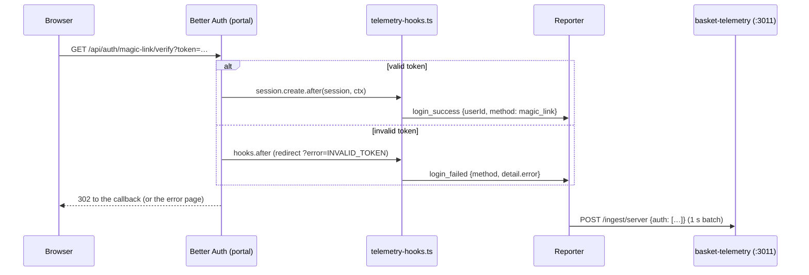
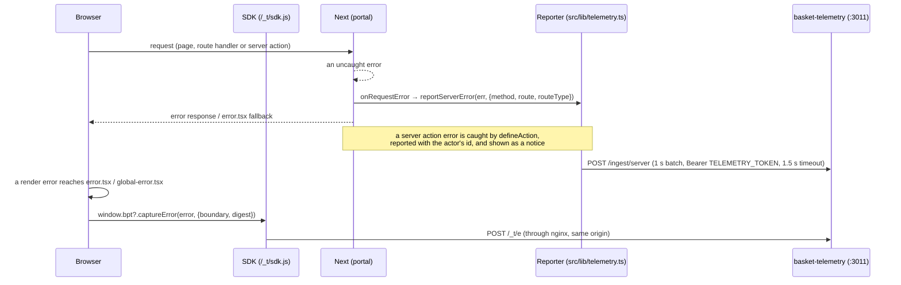

# Telemetry

The portal reports to [basket-telemetry](https://github.com/WencesCapolo/basket-telemetry), the superadmin panel on
`server.basket-app.com`: page views, active time, clicks and browser errors through the SDK, and server errors and a
few business events through a server reporter, and auth events (basket-telemetry SPEC §11, tasks T1.9 and T2.5). How an app integrates, the
reporter contract and the privacy rules are in
[basket-telemetry/docs/sdk.md](https://github.com/WencesCapolo/basket-telemetry/blob/main/docs/sdk.md); this page
covers the portal only.

Nothing personal leaves the portal in an event: props are ids, counts and enums, never emails, names or free text.
Error messages are scrubbed before they are sent (see below).

## What is sent

| From | What | Where |
|---|---|---|
| Browser | page views, active time, clicks, `window.onerror` and `unhandledrejection` | the SDK: `<Script src="/_t/sdk.js">` in `src/app/layout.tsx`, after the 1-line stub that queues `window.bpt` calls until it loads |
| Browser | a render error that reaches the root | `src/app/error.tsx` and `src/app/global-error.tsx` call `window.bpt?.captureError` (`captureBoundaryError` in `src/lib/telemetry-browser.ts`) and show the Spanish fallback (`src/components/errors/error-fallback.tsx`) |
| Server | an uncaught error of a render, route handler, server action or the proxy | `onRequestError` in `src/instrumentation.ts`, with the method, the route pattern (`/match/[id]`, never the concrete path) and the route type; `register()` and its schedulers are unchanged |
| Server | an error thrown inside a server action's `run` | `src/lib/actions/define-action.ts`, with the actor's Better Auth id. Parse failures, a returned `{ error }` and an authz failure shown as a notice are not reported |
| Server | business events | the actions below |

`window.bpt` is typed in `src/types/bpt.d.ts`, copied from basket-telemetry `src/sdk/sdk.d.ts`.

The server reporter is `src/lib/telemetry.ts` (`reportServerError`, `trackServerEvent`). It batches for 1 s and sends
one `POST` to the loopback ingest with `Authorization: Bearer <TELEMETRY_TOKEN>` (body per SPEC §6.2: `v: 1`,
`events`, `errors`). It aborts a send after 1.5 s, never throws, is never awaited on a response path, and caps its
queue at 200 items. Without `TELEMETRY_TOKEN` (dev, tests, CI) it does nothing. An error message is cut at `params:`
(a failed query's parameters) and has emails, quoted values, objects and numbers masked; the stack keeps its frames.

## Business events

| Event | When | Where | Props |
|---|---|---|---|
| `match_created` | a match is created | `createMatch` in `src/app/actions/matches.ts` | `match_id`, `has_assignments`, `staff_count` (assignments with a person) |
| `staff_assigned` | an assignment is saved | `upsertAssignment`, same file | `match_id`, `role_name`, `is_new` (the role had no assignment row before) |
| `match_notifications_sent` | a manual send reached at least one recipient | `sendAllMatchNotifications` / `sendAssignmentNotifications` in `src/app/actions/notifications.ts` | `match_id`, `recipients_count`, `scope` (`all`, `assignments`) |
| `grid_synced` | a manual grid sync ran (not skipped) | `syncGridAction` in `src/app/actions/grid-sync.ts` | `created`, `updated` |
| `access_request_submitted` | a Solicitud is filed | `submit` in `src/app/actions/access-requests.ts` | `app`, `role` (the requested Función, or null) |
| `access_request_approved` | a Solicitud is approved | `approve` in `src/app/actions/access-requests.ts` (portal) and `src/app/actions/app-access-requests.ts` (siblings, apex) | `app`, `role` |

Each event carries the actor's Better Auth id as `userId`.

## Auth events

The portal is the only auth server, so only it reports auth events (`reportAuthEvent` in `src/lib/telemetry.ts`, the
batch's `auth` array, accepted by the ingest from the `portal` token only). The Better Auth wiring is
`src/lib/auth/telemetry-hooks.ts`, spread into the config in `src/lib/auth/server.ts`.

| Event | When | Where | Fields |
|---|---|---|---|
| `login_success` | a session is created | `databaseHooks.session.create.after` | `userId`, `method`: `magic_link`, the OAuth provider id (`google`) or `impersonation` |
| `login_failed` | a sign-in endpoint (`/sign-in/magic-link`, `/magic-link/verify`, `/callback/:id`, `/sign-in/social`) returns an error, or redirects with `?error=` | `hooks.after` | `method`, `detail.error` (Better Auth's code, e.g. `INVALID_TOKEN`), `email` only for a failed magic link request |
| `magic_link_requested` | `/sign-in/magic-link` succeeds | `hooks.after` | `method`; `userId` when an identity has the address, otherwise the `email` |
| `logout` | a session is deleted by `/sign-out` (a revoke or a ban is not a logout) | `databaseHooks.session.delete.after` | `userId` |
| `no_access` | `/no-access` shows the form or a pending Solicitud | `src/app/(auth)/no-access/page.tsx` (`reportNoAccess` in `src/lib/access-requests/no-access.ts`) | `userId`, `app` (the requested app, resolved against the catalog), `detail.view` |

An email is sent only when there is no user id, trimmed and lower-cased. The hooks never throw into Better Auth and
never wait on the ingest; the identity lookup of a magic link request runs after the response.

A magic link verify: a login or a failed login, reported without delaying the redirect.

## Other links

- `/usuarios` (apex) links every identity to its page in the panel, `https://server.basket-app.com/users/<authUserId>`
  ("Ver actividad", `src/lib/usuarios/activity-link.ts`).

## Environment

| Variable | Default | Note |
|---|---|---|
| `TELEMETRY_INGEST_URL` | `http://127.0.0.1:3011/ingest/server` | basket-telemetry's server ingest, on loopback (nginx does not expose it) |
| `TELEMETRY_TOKEN` | empty: nothing is sent | the `portal` token in basket-telemetry's `INGEST_TOKENS`; only in the VPS env |

## Source maps

`productionBrowserSourceMaps: true` (`next.config.ts`) writes the browser `.map` files next to the chunks in
`.next/static`, where basket-telemetry reads them to resolve browser stacks. They must never be public: deploy this
only after nginx denies `*.map` (basket-telemetry `deploy/wizard-f0.sh`).

## The path of an error

A server error and a browser error, each on its own path to basket-telemetry.
